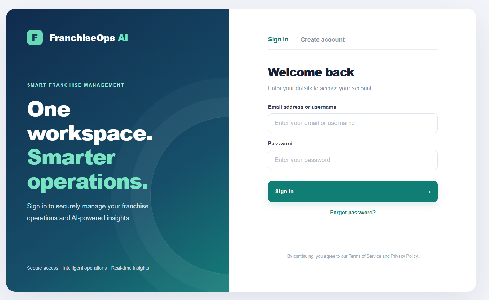
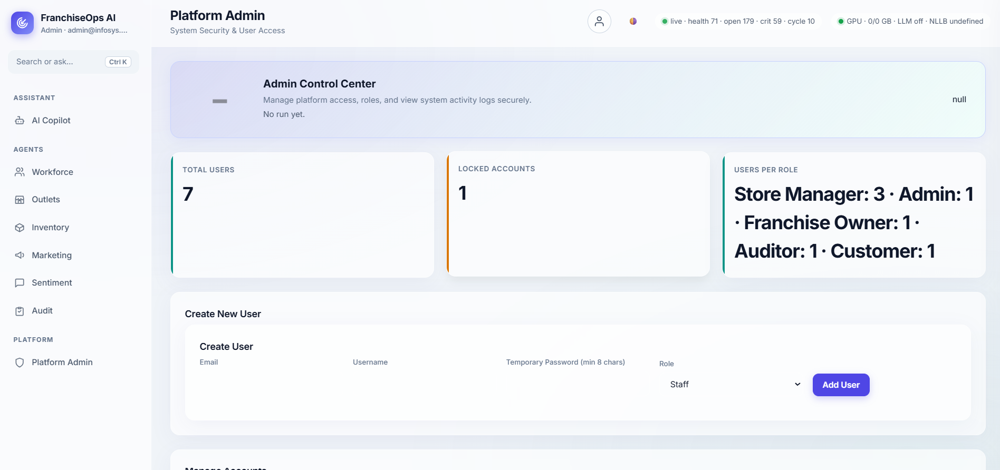
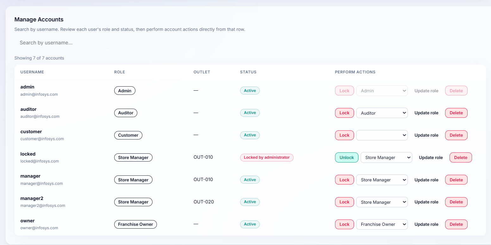
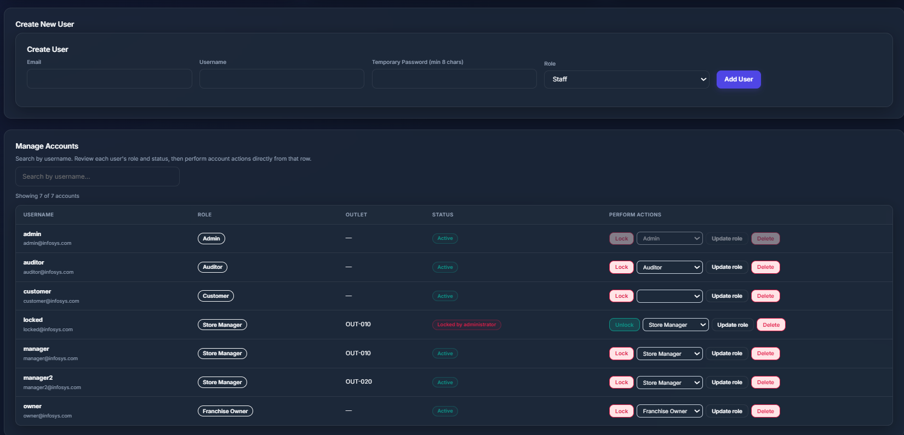
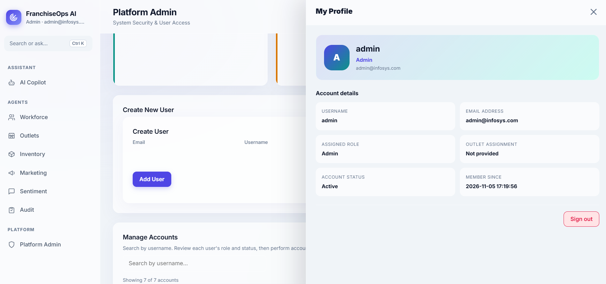

# 🚀 FranchiseOps AI
### Enterprise Multi-User Intelligence Platform


<p align="center">
  
  
  
  
  
  
</p>

---

## 📌 Project Overview

**FranchiseOps AI** is an intelligent, secure and multi-user franchise operations management platform developed as part of **Infosys Springboard Internship 7.0 – Milestone 2**.

The project transforms a single-user franchise operations prototype into an enterprise-oriented, role-based multi-tenant platform. It integrates secure authentication, granular authorization, operational analytics, six autonomous background agents and an SQL-powered AI Copilot into one unified application.

The platform enables administrators, franchise owners, store managers, staff members and auditors to access operational information according to their responsibilities and permissions.

Unlike systems that generate unsupported answers, the AI Copilot is designed around deterministic, whitelisted SQL queries so that operational answers are grounded in database records.

### 🎯 Project Objectives

- Integrate the Milestone 1 authentication system with the provided FastAPI application.
- Implement secure JWT-based authentication and account protection.
- Introduce five distinct user roles with server-side RBAC.
- Restrict Store Manager data access to the assigned outlet.
- Develop an administrative dashboard for centralized user management.
- Improve the SQL-powered AI Copilot with 15+ additional question patterns.
- Integrate six autonomous operational agents.
- Improve the frontend with a responsive interface and dark mode.
- Provide secure and controlled access to franchise operational information.

---

## 🌟 Key Features

| Feature | Description |
|---|---|
| 🔐 Secure Authentication | Signup, login, password recovery, JWT sessions and logout |
| 🛡️ Role-Based Access Control | Five roles with granular server-side permissions |
| 👤 User Profile | Account information and secure profile updates |
| 🧑‍💼 Admin Dashboard | User management, role assignment, account locking and KPIs |
| 🤖 AI Copilot | Database-grounded answers using whitelisted SQL |
| 👥 Workforce Agent | Workforce analysis and attrition-related insights |
| 🏬 Outlets Agent | Outlet health scoring and performance ranking |
| 📦 Inventory Agent | Stock monitoring and reorder alerts |
| 📢 Marketing Agent | Campaign performance analysis |
| 💬 Sentiment Agent | Customer feedback and sentiment analysis |
| 🧾 Audit Agent | Compliance monitoring and audit findings |
| 🌙 Dark Mode | Improved interface with dark theme support |
| ⚡ Background Workers | Automated operational agent cycles and ticket generation |

---

# 🧰 Technology Stack

## Backend Technologies

| Technology | Purpose |
|---|---|
| Python | Core application development |
| FastAPI | High-performance backend and REST APIs |
| SQLite | Relational database management |
| Python sqlite3 | Database connectivity and query execution |
| PyJWT | JSON Web Token creation and verification |
| bcrypt / PBKDF2 | Secure password hashing |
| Uvicorn | ASGI application server |

## Frontend Technologies

| Technology | Purpose |
|---|---|
| HTML5 | Application structure |
| CSS3 | Responsive styling and visual design |
| JavaScript | Dynamic frontend functionality |
| Vanilla JavaScript | Single-page application logic |
| Dynamic UI Blocks | Rendering operational dashboards and data |
| CSS Dark Mode | Light/dark interface support |

## Deployment and Development

- Google Colab – notebook-based execution environment.
- ngrok – public tunneling for application access.
- GitHub – source code management and project documentation.

---

# 🏗️ System Architecture

FranchiseOps AI follows a modular architecture in which the frontend communicates with the FastAPI backend through REST APIs.

```text
                    ┌─────────────────────────────┐
                    │         USER INTERFACE      │
                    │                             │
                    │ Login | Signup | Dashboard  │
                    │ Profile | Admin | Copilot   │
                    │ Six Operational Agent Pages│
                    └──────────────┬──────────────┘
                                   │
                              REST APIs
                                   │
                                   ▼
                    ┌─────────────────────────────┐
                    │          FASTAPI            │
                    │                             │
                    │ Authentication Middleware   │
                    │ JWT Token Validation        │
                    │ Role-Based Access Control   │
                    │ API Request Handling        │
                    └──────────────┬──────────────┘
                                   │
                ┌──────────────────┼──────────────────┐
                │                  │                  │
                ▼                  ▼                  ▼
       ┌────────────────┐ ┌────────────────┐ ┌────────────────┐
       │ Authentication │ │ RBAC & Outlet  │ │  AI Copilot    │
       │                │ │ Scope Control  │ │                │
       │ Signup / Login │ │                │ │ SQL Whitelist  │
       │ Password Reset │ │ Permissions    │ │ Query Analysis │
       │ JWT / Logout   │ │ Authorization  │ │ SQL Results    │
       └───────┬────────┘ └───────┬────────┘ └───────┬────────┘
               │                 │                  │
               └─────────────────┼──────────────────┘
                                 │
                                 ▼
                    ┌─────────────────────────────┐
                    │         SQLITE DATABASE     │
                    │                             │
                    │ User Information             │
                    │ Franchise Operational Data  │
                    │ Agent Records and Tickets   │
                    │ Audit and Activity Records  │
                    └──────────────┬──────────────┘
                                   │
                                   ▼
                    ┌─────────────────────────────┐
                    │     BACKGROUND WORKERS      │
                    │                             │
                    │ Workforce Agent             │
                    │ Outlets Agent                │
                    │ Inventory Agent              │
                    │ Marketing Agent              │
                    │ Sentiment Agent              │
                    │ Audit Agent                  │
                    └─────────────────────────────┘
```

### Architecture Highlights

1. **Frontend Layer:** Provides login, dashboard, profile, administration, Copilot and agent interfaces.
2. **API Layer:** FastAPI handles incoming requests and application operations.
3. **Authentication Layer:** Verifies JWT tokens and authenticated user identities.
4. **Authorization Layer:** Enforces role permissions and outlet-level access restrictions.
5. **Database Layer:** Stores user information and franchise operational records.
6. **Agent Layer:** Runs operational analysis and records agent-generated tickets.
7. **Copilot Layer:** Executes approved SQL patterns and returns database-backed responses.

---

# 🔐 1. Authentication and Security

The authentication module integrates the Milestone 1 login and account recovery functionality into the FastAPI application.

### JWT-Based Authentication

- Secure user login using email and password.
- Signed JWT access tokens.
- Token transmission through the HTTP Authorization header.
- Bearer-token validation for protected API requests.
- Token revocation during logout.
- Immediate rejection of tokens belonging to locked accounts.

Example authorization header:

```http
Authorization: Bearer <access_token>
```

### Password Security

- Password hashing using bcrypt or PBKDF2.
- Minimum password length of eight characters.
- At least one uppercase character.
- At least one lowercase character.
- At least one numeric character.
- At least one special character.
- Password confirmation during registration and recovery.
- Current-password verification before password changes.

### Account Protection

| Security Feature | Behaviour |
|---|---|
| Failed Login Attempts | Account lockout after five consecutive incorrect passwords |
| Generic Login Errors | Prevents revealing whether an email exists |
| JWT Validation | Checks token authenticity and validity |
| Token Revocation | Invalidates logged-out sessions |
| Account Locking | Prevents locked users from accessing protected APIs |
| Password Reset | Supports account recovery |
| Credential Protection | Passwords are never displayed in the frontend |

---

# 🛡️ 2. Role-Based Access Control (RBAC)

The application implements five distinct roles.

Permissions are enforced on the backend using:

- `ROLE_MENU` – Defines which pages a role can access.
- `ROLE_CAPS` – Defines which operations a role can perform.
- `menu_for(user)` – Returns permitted navigation items.
- `need(ctx, capability)` – Validates access to protected operations.

Unauthorized requests are rejected with:

```http
HTTP/1.1 403 Forbidden
```

### UI
- `Login Page`

- `Admin Dashboard`

- `Individual Agents Analysis`


 
 

- `Admin Tasks`



- `Profile`

### Role Descriptions

**1. Admin – Platform Administrator**

- Complete access to all application pages.
- Run all operational agents.
- Create and delete user accounts.
- Promote and demote user roles.
- Lock and unlock accounts.
- View administrative activity logs.
- Monitor platform-level KPIs.

**2. Franchise Owner**

- Access all six operational agents.
- Use the AI Copilot.
- View franchise-wide operational insights.
- Run operational agent cycles.
- Cannot manage user accounts.

**3. Store Manager**

- Access Workforce, Outlets, Inventory, Sentiment and Audit.
- View information only for the assigned outlet.
- Ask permitted outlet-specific Copilot questions.
- Cannot access Marketing.
- Cannot run agents or manage users.

**4. Staff**

- Access personal Profile information.
- Use Copilot for greetings and permitted own-outlet questions.
- Cannot access operational agent pages.
- Cannot manage users or execute agent operations.

**5. Auditor**

- Read-only access to all six operational pages.
- Access compliance and audit information.
- Cannot execute agents.
- Cannot modify operational information.
- Cannot manage user accounts.

### 📊 Role and Permission Matrix

| Role | Copilot | Workforce | Outlets | Inventory | Marketing | Sentiment | Audit | Run Agents | User Management |
|---|:---:|:---:|:---:|:---:|:---:|:---:|:---:|:---:|:---:|
| **Admin** | ✓ | ✓ | ✓ | ✓ | ✓ | ✓ | ✓ | ✓ | ✓ |
| **Franchise Owner** | ✓ | ✓ | ✓ | ✓ | ✓ | ✓ | ✓ | ✓ | ✗ |
| **Store Manager** | ✓ | ✓* | ✓* | ✓* | ✗ | ✓* | ✓* | ✗ | ✗ |
| **Staff** | ✓† | ✗ | ✗ | ✗ | ✗ | ✗ | ✗ | ✗ | ✗ |
| **Auditor** | ✓ | ✓ | ✓ | ✓ | ✓ | ✓ | ✓ | ✗ | ✗ |

- `*` Store Manager access is restricted to the assigned outlet.
- `†` Staff Copilot access is limited to greetings and permitted own-outlet questions.
- Auditor permissions are read-only.

**Important:** Page visibility is not the only security check. The backend must also validate direct API requests and enforce outlet scope on database queries.

---

# 🧑‍💼 3. Comprehensive Admin Dashboard

The Admin Dashboard provides centralized platform management.

### User Management Table

The dashboard provides visibility into:

- Email address
- Username
- Assigned role
- Account status
- Account creation date
- Last login time

### Administrative Operations

| Operation | Description |
|---|---|
| Add User | Create a new user with a temporary password and role |
| Delete User | Remove an account after confirmation |
| Promote User | Assign a higher-level role |
| Demote User | Assign a lower-level role |
| Lock Account | Prevent an account from logging in |
| Unlock Account | Restore access to a locked account |
| View Activity | Review recent administrative actions |

### Security Guardrails

- An administrator cannot lock their own account.
- An administrator cannot delete their own account.
- The last remaining Admin account cannot be deleted or demoted.
- Locked users must be rejected even when using previously issued tokens.
- Passwords and password hashes must never appear in the dashboard.

### Admin Dashboard KPIs

- Total registered users.
- Users grouped by role.
- Total locked accounts.
- Latest 50 administrative activity records.

---


---

# ⚙️ 4. Six Autonomous Background Agents

FranchiseOps AI includes six operational agents that continuously evaluate franchise-related information through background worker processes.

The agents are implemented around `live_engine.py` and `worker.py`.

### 👥 Agent 1 – Workforce

**Purpose:** Monitor workforce-related operational information.

Key responsibilities:
- Analyze staffing levels.
- Identify workforce-related concerns.
- Provide attrition-related insights.
- Support workforce planning.

### 🏬 Agent 2 – Outlets

**Purpose:** Evaluate outlet performance and operational health.

Key responsibilities:
- Calculate outlet health scores.
- Compare outlet performance.
- Rank outlets.
- Highlight operational concerns.

### 📦 Agent 3 – Inventory

**Purpose:** Monitor stock availability and inventory risks.

Key responsibilities:
- Analyze stock coverage.
- Identify items below reorder levels.
- Detect potential stock shortages.
- Generate reorder-related tickets.

### 📢 Agent 4 – Marketing

**Purpose:** Evaluate franchise marketing activities.

Key responsibilities:
- Analyze campaign performance.
- Compare campaign results.
- Provide campaign ROI insights.
- Identify marketing performance trends.

### 💬 Agent 5 – Sentiment

**Purpose:** Understand customer feedback and satisfaction.

Key responsibilities:
- Analyze customer reviews.
- Identify positive and negative sentiment.
- Monitor feedback trends.
- Highlight customer experience concerns.

### 🧾 Agent 6 – Audit

**Purpose:** Support franchise compliance and operational monitoring.

Key responsibilities:
- Perform compliance checks.
- Identify audit findings.
- Track audit-related tickets.
- Highlight operational and security concerns.

### Background Processing

The background worker architecture allows agent cycles to run independently of normal page navigation. Agent actions are recorded as operational tickets for tracking and review.

---

# 👤 6. User Profile Management

The Profile page provides user-specific account information.

### Profile Information

- Username
- Email address
- Assigned role
- Account creation date
- Last login time

### Profile Operations

- Update username.
- Change password.
- Verify the current password before changing credentials.
- Apply password validation rules.
- Protect sensitive authentication information.

---

# 🔌 API and Backend Overview

The application uses FastAPI endpoints to communicate between the browser and backend.

The following routes represent the main application functionality. Refer to the final notebook's route definitions for the complete endpoint list.

| Method | Endpoint | Purpose |
|---|---|---|
| GET | `/api/me` | Retrieve current user and permitted menu |
| GET | `/api/page/{id}` | Load an operational page |
| GET | `/api/detail/{id}` | Retrieve entity details |
| POST | `/api/copilot` | Submit a Copilot question |
| POST | `/api/run_cycle` | Execute an agent cycle |
| POST | `/api/auth/signup` | Register a user |
| POST | `/api/auth/login` | Authenticate a user |
| POST | `/api/auth/logout` | Revoke the active session |
| POST | `/api/auth/forgot/...` | Password recovery operations |

FastAPI interactive API documentation may be available at:

```text
/docs
```

---

# ⚙️ Getting Started

## 1. Prerequisites

Before running the project, ensure you have:

- A Google account.
- Access to Google Colab.
- The Milestone 2 project notebook.
- An ngrok account if the tunnel fallback is required.
- Gmail app password if email OTP delivery is enabled.

## 2. Configure Google Colab Secrets

Open Google Colab and select the **Secrets** icon (key symbol) from the left sidebar.

Configure the following secrets:

| Secret Name | Description |
|---|---|
| `JWT_SECRET` | Secret key used to sign JWT tokens |
| `NGROK_AUTHTOKEN` | ngrok authentication token |
| `EMAIL_ADDRESS` | Gmail sender address |
| `EMAIL_PASSWORD` | Gmail app password |

Use the exact variable names expected by the submitted notebook.

**Security reminder:** Never hard-code passwords, JWT keys, OTP credentials or ngrok tokens inside notebook cells or GitHub files.

## 3. Open the Notebook

Open:

```text
Milestone2_FranchiseOps_FastAPI.ipynb
```

in Google Colab.

## 4. Execute the Application

1. Select **Runtime → Run all**.
2. Allow the dependency installation and database initialization cells to finish.
3. Wait for the FastAPI server startup message.
4. Wait for the application access link.
5. Click **Open the app**.
6. If the Colab proxy is unavailable, configure the ngrok secret and run the tunnel cell.

## 5. Access the Application

Once the application is running:

- Sign up for a new account or use an existing account.
- Log in with valid credentials.
- Open the dashboard.
- Verify the navigation items available for the logged-in role.
- Test the permitted pages and actions.

> **Runtime note:** Google Colab sessions are temporary. Runtime files and SQLite databases may be lost when a session is reset unless persistence is configured.

---

# 🧪 Testing and Validation

The application should be tested across authentication, authorization, Copilot, agent execution and frontend functionality.

| Test Category | Test Cases |
|---|---|
| Authentication | Signup, login, invalid password, password recovery |
| Account Security | Five failed attempts, account lockout, logout |
| JWT | Missing token, invalid token, revoked token |
| RBAC | Page access for all five roles |
| API Security | Direct unauthorized API requests return 403 |
| Outlet Scope | Store Manager cannot access another outlet |
| Admin | Add, delete, promote, demote, lock and unlock |
| Admin Safety | Self-delete protection and last-Admin protection |
| Copilot | Greetings, SQL answers, unsupported questions |
| SQL Security | Whitelisted queries and role-based filtering |
| Agents | Test all six operational pages and execution permissions |
| Profile | Profile details and secure credential updates |
| Frontend | Dark mode, responsive layout, loading and error messages |

### Recommended Screenshots

Add screenshots of the actual running application to the GitHub repository.

| Screenshot | Filename |
|---|---|
| Login Page | `login.png` |
| Signup Page | `signup.png` |
| Main Dashboard | `dashboard.png` |
| User Profile | `profile.png` |
| Admin Dashboard | `admin-dashboard.png` |
| RBAC Denied Access | `rbac-denied-403.png` |
| Copilot Greeting | `copilot-greeting.png` |
| Copilot SQL Answer | `copilot-sql-answer.png` |
| Workforce Agent | `agent-workforce.png` |
| Outlets Agent | `agent-outlets.png` |
| Inventory Agent | `agent-inventory.png` |
| Marketing Agent | `agent-marketing.png` |
| Sentiment Agent | `agent-sentiment.png` |
| Audit Agent | `agent-audit.png` |

---


# 🚀 Future Enhancements

Potential improvements beyond the current Milestone 2 scope include:

1. **Advanced Analytics:** Interactive operational dashboards with additional historical comparisons.
2. **Predictive Inventory:** Forecast inventory requirements and potential stock shortages.
3. **Workforce Forecasting:** Predict staffing requirements using historical workforce data.
4. **Enhanced Copilot:** Expand supported SQL question patterns and conversational context while retaining database-grounded answers.
5. **Automated Notifications:** Notify authorized users about critical inventory, compliance and outlet events.
6. **Persistent Cloud Database:** Move from temporary notebook storage to managed database infrastructure.
7. **Production Deployment:** Deploy the FastAPI application to a secure cloud hosting platform.
8. **Advanced Monitoring:** Add application health monitoring, structured logs and operational metrics.

---


---

# 👩‍💻 Team Contributions

The project is developed collaboratively by a four-member team.

| Team Member | Responsibility | Main Work |
|---|---|---|
| Shruti | Authentication & Security | Login, signup, password recovery, JWT and account protection |
| Ayush | RBAC & Profile | Role permissions, outlet scope and Profile page |
| Dhanush | Admin Dashboard | User management, role changes, account locking and activity logs |
| Sujal | AI Copilot & Backend | SQL query patterns, question handling and RBAC integration |


---

<div align="center">

## 💙 FranchiseOps AI

**Built as part of Infosys Springboard Internship 7.0**

*Transforming franchise operations through secure access, intelligent automation and data-driven insights.*

</div>
